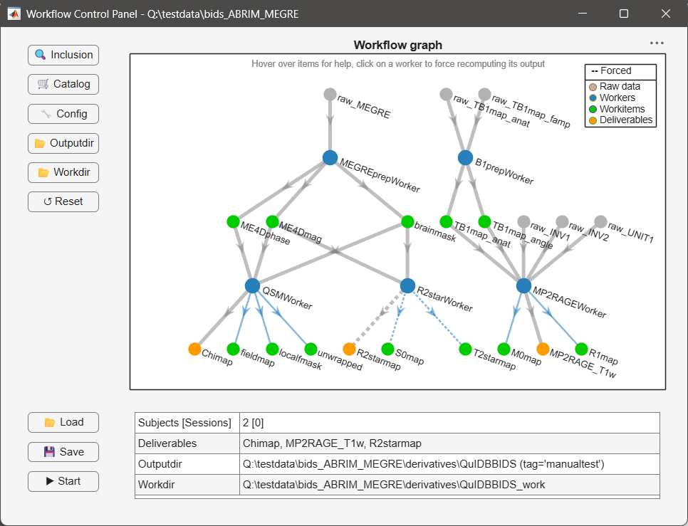
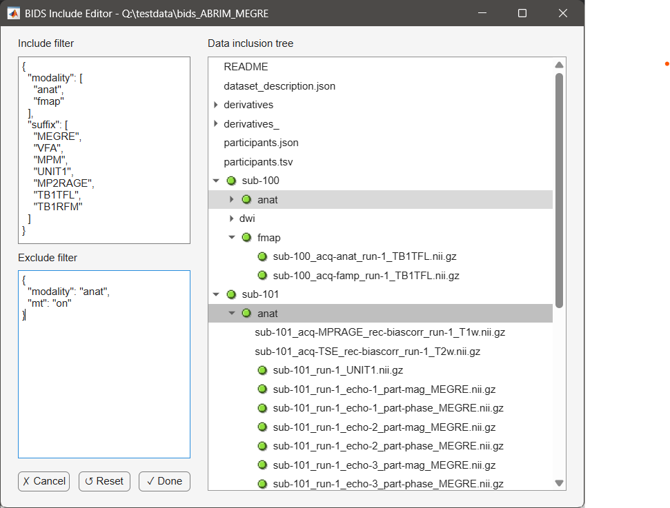
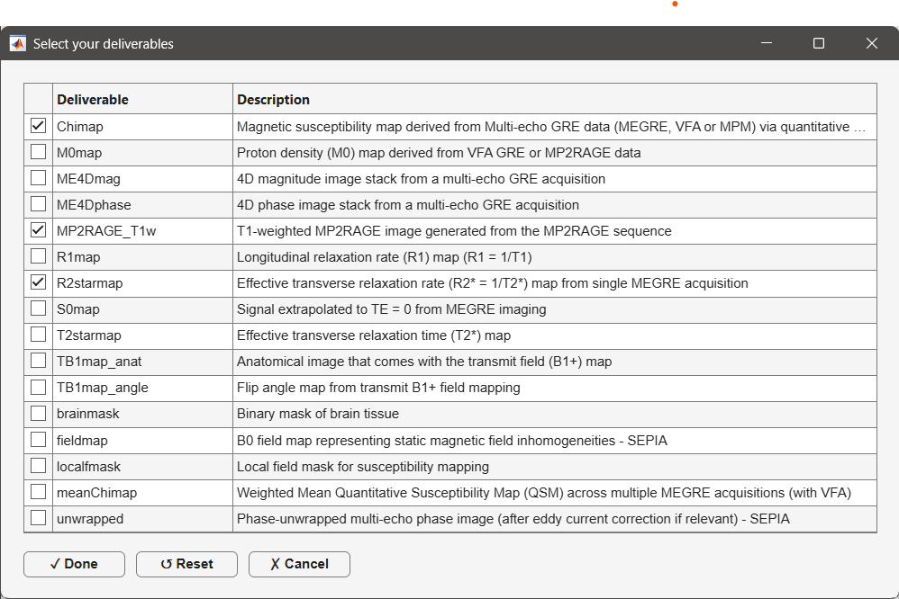
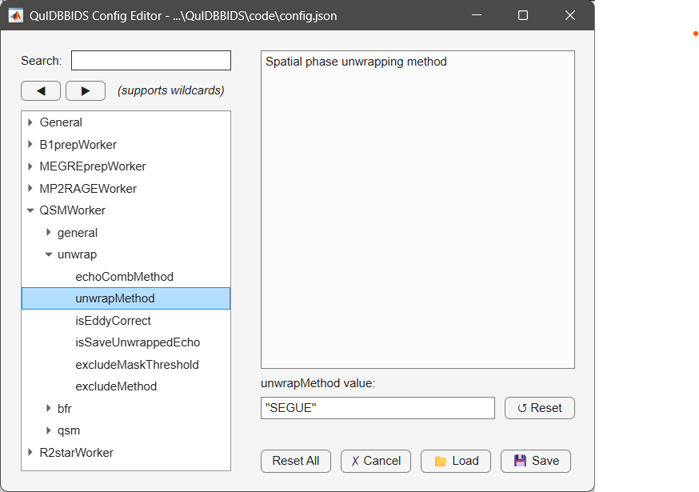

Graphical User Interface
========================

The main window: Workflow Control Panel
---------------------------------------
QuIDBBIDS provides a main graphical user interface (GUI) — the *Workflow Control Panel* — for users that prefer
an interactive approach to workflow configuration and execution. To launch it in GUI mode, call
``qb.QuIDBBIDS()`` with no input arguments and select your BIDS folder in the file dialog:

.. code-block:: matlab

   >> qb.QuIDBBIDS();            % Initialize the Workflow Control Panel

.. note::

   All sub-GUIs described in the sections below can also be opened directly from the MATLAB command line (see :doc:`CLI`).
   Because ``QuIDBBIDS`` is a handle class, a sub-GUI called from your object always shares its state, so GUI and command
   line line stay in sync. Available calls:

   .. code-block:: matlab

      >> quidb = qb.QuIDBBIDS();    % Assign the QuIDBBIDS object (pass a BIDS folder to start directly in CLI mode)
      >> quidb.edit_inclusion()     % Open the BIDS include/exclude filter editor -> [🔍 Inclusion]
      >> quidb.set_deliverables()   % Open the deliverables selection GUI         -> [🛒 Catalog]
      >> quidb.edit_config()        % Open the config editor                      -> [🔧 Config]

   You can always (re)open the main GUI from an assigned QuIDBBIDS object:

   .. code-block:: matlab

      >> quidb.start_GUI()          % Open the Workflow Control Panel (with current settings)

The Workflow Control Panel that now opened is organized in the areas shown in the figure below:

   The Workflow Control Panel: setup buttons on the left, the workflow graph in the center, the workflow control
   buttons (:guilabel:`📂 Load`/:guilabel:`💾 Save`/:guilabel:`▶ Start`) at the bottom left, and a summary table
   of the dataset and settings at the bottom right.

* **Left panel — setup buttons.** These buttons guide you through the workflow setup step by step; they are
  enabled or disabled depending on how far you are in the setup process:

  * :guilabel:`🔍 Inclusion` — Edit the BIDS include/exclude filter that selects which raw data are used in the workflow.
    Opens the inclusion editor GUI (see below).
  * :guilabel:`🛒 Catalog` — Select your deliverables (output items such as ``R1map`` and ``MWFmap``) from the catalog of
    workitems that the available workers can produce for your dataset. Opens the deliverables GUI (see below).
    Selecting deliverables builds the workflow team and draws the workflow graph in the center panel.
  * :guilabel:`🔧 Config` — Edit the processing settings and options per worker. Opens the config editor GUI (see below).
  * :guilabel:`📂 Outputdir` — Set the directory where the output data (deliverables) will be saved.
  * :guilabel:`📂 Workdir` — Set the directory where intermediate working data will be saved.
  * :guilabel:`↺ Reset` — Clear all deliverables and reset the workflow graph and configuration to the defaults.

* **Center panel — workflow graph.** When the panel opens, the center first shows the *workflow mask*: all
  registered workers and workitems, with the ones discarded because their input data is missing from your dataset
  greyed out. Only after you select deliverables (:guilabel:`🛒 Catalog`) or load saved settings (:guilabel:`📂 Load`)
  does the center switch to the *workflow graph* of the assembled team (as in the figure above): raw input data at the top
  (grey nodes prefixed with ``raw_``, e.g. ``raw_MEGRE``), the selected team of workers in the middle (blue nodes), and
  the output deliverables at the bottom (orange nodes, e.g. ``Chimap`` and ``R1map``). The graph is redrawn
  automatically when you change the inclusion filter or the deliverables. Hover over a node to see what it does;
  click a worker node to force recomputing its output (dotted lines), or click a workitem node to add/remove it from
  the deliverables.

* **Bottom-right — info table.** A summary of the BIDS dataset and current workflow settings: number of
  subjects/sessions, the selected deliverables, and the output and working directories.

* **Bottom-left panel — workflow control buttons:**

  * :guilabel:`📂 Load` — Load previously saved workflow settings (both the coordinator and the manager properties).
  * :guilabel:`💾 Save` — Save your current workflow settings.
  * :guilabel:`▶ Start` — Save the settings and start the workflow. All buttons are disabled while the workflow runs; when
    the workflow has completed, an info dialog is shown.

The sub-GUIs described in the sections below are launched from the buttons in the Workflow Control Panel.

Inclusion editor
----------------
The :guilabel:`🔍 Inclusion` button in the Workflow Control Panel opens a GUI to edit the include and exclude filters that
determine which raw BIDS data are included in the workflow.

The GUI shows two JSON text areas — one for the include filter and one for the exclude filter — next to a tree
view of your BIDS dataset. As you edit the filters, the tree is updated live and included files and folders are
tagged with a green-dot icon. Use :guilabel:`↺ Reset` to restore the original filters, :guilabel:`✗ Cancel` to discard your changes, or
:guilabel:`✓ Done` to apply them. When applied, the BIDS dataset is re-indexed with the new filter and the workflow graph in
the Workflow Control Panel is redrawn.

   The inclusion editor: include/exclude filters as JSON (left) and the BIDS data tree with included items tagged
   by green dots (right).

Deliverables catalog
--------------------
The :guilabel:`🛒 Catalog` button in the Workflow Control Panel opens a GUI with a table of all workitems that the available
workers can produce for your dataset, together with their descriptions.

Tick the checkboxes of the deliverables you want (e.g. ``R1map`` and ``MWFmap``) and press :guilabel:`✓ Done` (or :guilabel:`↺ Reset` to
restore the previous selection, :guilabel:`✗ Cancel` to discard). If multiple workers can produce one of your deliverables, a
worker-selection GUI pops up in which you can choose the worker to use, showing each candidate's description, the
workitems it needs, and the workitems it makes.

   The deliverables catalog: all workitems that the available workers can produce for your dataset, with their
   descriptions, and checkboxes to select the desired deliverables.

Processing settings and options
-------------------------------
All configuration settings and options for processing the data can be set per worker with a GUI — the config
editor — launched from the :guilabel:`🔧 Config` button in the Workflow Control Panel:

   Left panel: The General QuIDBBIDS settings as well as the settings for the individual workers. In this
   example the user navigated to a ``QSMWorker`` SEPIA menu item (e.g. ``QSM.qsm`` or ``QSM.unwrap``) — editing
   its value opens the native SEPIA GUI (see below). Right panel: the description of the
   selected parameter (top) with a box to edit its current value (bottom). Other (non-SEPIA) parameters can be
   edited directly in the value box.

The ``QSMWorker`` (QSM) and ``R2starWorker`` (R2* relaxometry) both use the SEPIA toolbox, which comes with its own
collection of settings. If a ``QSMWorker`` or ``R2starWorker`` setting represents a SEPIA menu item (i.e., an option
that defines a set of SEPIA processing options rather than just a single setting — e.g. the ``unwrap``, ``bfr``,
``qsm`` or ``r2s`` subtrees, as in the figure above), QuIDBBIDS launches a minimal native SEPIA GUI, allowing you to
adjust the SEPIA settings in there. Settings that are not menu items (e.g., numerical parameters) can be edited
normally in the value box.

General settings
~~~~~~~~~~~~~~~~
The settings in ``General`` apply to all Workers and workflow in general. Here you can add your settings to use
any parallel compute resources, for instance whether or how to use your HPC cluster or GPU. A few settings are of 
particular interest:

   * ``tag``. A custom tag that is added to the deliverables, e.g. to distinguish or compare the results when using
     different parameter settings. In such use cases, you could iteratively: (1) update the config parameter(s) and
     output tag, (2) delete or force the workitems that need to be re-computed from the work-folder (3) execute the
     workflow. In this way unaffected work-items in the work-folder can be reused, while the deliverables are save
     with different tags in the output-folder.
     
   * ``useHPC`` / ``HPC``. Set ``useHPC`` to ``true`` to run the workflow on an HPC cluster, submitting each job
     with ``qsubfeval()`` (requires the qsub toolbox). The ``HPC`` setting holds the resource requirements as a
     name-value cell array that is passed on to ``qsubfeval()`` — by default ``["memreq", 10e9, "timreq", 36000]``,
     i.e. 10 GB memory and 10 hours walltime per job (see ``config_default.json``).

   * ``useParallel``. Set to ``true`` to process subjects in parallel on the local machine with ``parfeval()``
     (this option is ignored when ``useHPC`` is ``true``).

Run the workflow
----------------

To run the workflow from the GUI, press the :guilabel:`▶ Start` button in the Workflow Control Panel. This saves your settings
and starts the workflow; all buttons are disabled while the workflow runs. See :doc:`CLI` for running the workflow
from the command line (including forcefully re-running (subtrees of) workflows).
