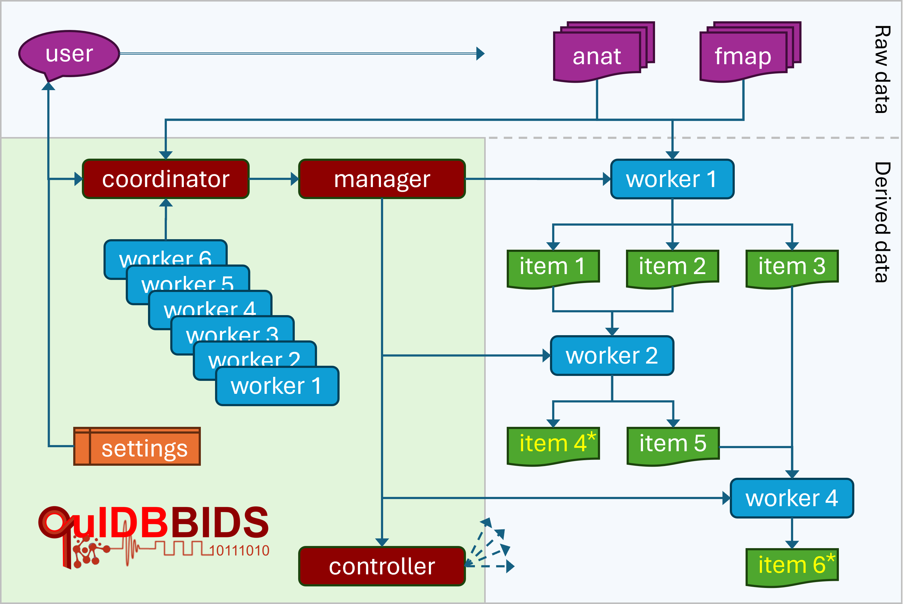
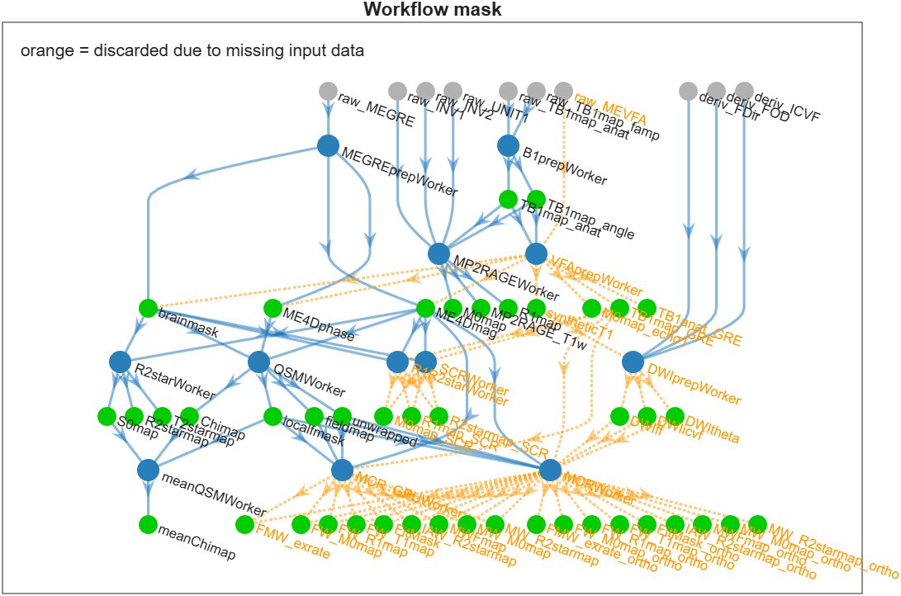
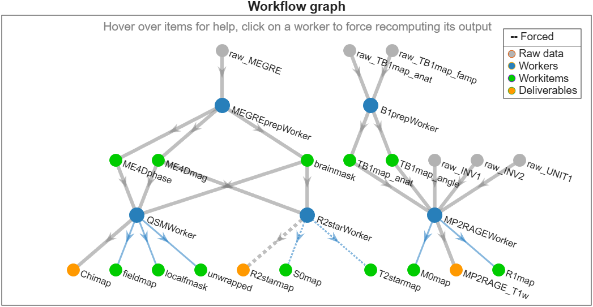

Architecture
============

Inspired by human role-based workflows, QuIDBBIDS defines a hierarchy of specialized modules — Coordinator,
Manager, and Worker — designed to minimize workflow and BIDS-related overhead for developers
implementing new methods in Worker modules, as illustrated below.

.. note::

   A Controller module for automated quality control (QC) is planned but still work in progress —
   see the stub in ``+qb/+workers/Controller.m``.

   QuIDBBIDS Workflow Architecture. The user specifies the data and desired workitems (``4*`` and ``6*``)
   to the coordinator. The coordinator inspects the worker pool, interacts with the user to edit settings
   (algorithm parameters and additional metadata), and activates the manager. The manager puts workers ``1``,
   ``2``, and ``4`` into a team and directs them to process the input data (“anat” and “fmap”), collaboratively
   producing workitems ``1–6``. Finally, the manager initiates a controller (WIP) to verify successful completion.

* **Coordinator module** — The coordinator is named “QuIDBBIDS” and serves as the primary interface with the user,
  and assists in defining data management and processing options. This centralized coordination enhances the
  reproducibility and transparency of all executed workflows.

* **Manager module** — Based on the resumes of the Workers and the user’s declared output requests, the manager
  assembles a “team” of workers that collectively define a workflow — a network of interconnected work-items
  linking raw inputs to the requested results. The manager then orchestrates workflow execution on a per-subject
  basis, either sequentially on the local system or in parallel on a high-performance computing (HPC) cluster.
  Data access is automatically managed via locking and release mechanisms to ensure safe parallel operation. The
  manager monitors progress and oversees error logs; it will direct the Controller (work in progress) to
  generate comprehensive quality control (QC) reports for all completed tasks.

* **Worker modules** — Each worker represents a modular processing unit and maintains a resume that specifies the
  work-items it requires (for example, a coregistered B1 field map or magnitude and phase GRE data) and the
  work-items it produces (such as an R2* or R1 map). Workers communicate through inherited methods of the base
  worker module, allowing them to request required work-items from their peers. Upstream workers are triggered
  recursively when their outputs are needed, and existing items are reused unless forced recomputation is
  requested. Throughout execution, standardized logs ensure traceability and reproducibility.

Below is a real-world workflow example, illustrating how the right-hand side of the above architecture diagram
materializes in practice. First, the coordinator filters the full worker pool against the actual data in your BIDS
dataset: it applies the include/exclude filters to the BIDS layout and discards every worker whose required raw
input data is missing — those discarded workers and their subtrees are highlighted in orange in the mask below:

   The workflow "mask": all registered workers and workitems, with the workers/subtrees that are discarded because
   their raw input data is missing from the dataset highlighted in orange.

Once you select your deliverables (and workers, if applicable), the manager then assembles the team of remaining
workers that can produce them:

   A basic workflow instantiation with user-specified deliverables ``Chimap``, ``R2starmap``, and ``R1map``
   that are collaboratively produced by a team of workers (blue nodes). Raw input data (grey nodes prefixed with
   ``raw_*``, e.g., ``raw_MEGRE``) appear at the top, and the output deliverables (orange nodes) at the bottom.
   The dotted lines mark the downstream edges of forced workers: their outputs (and everything downstream of them)
   will be recomputed, even if results already exist in the work folder.

The QuIDBBIDS workflow is designed to be modular and flexible, allowing users to easily customize and extend
the processing workflow by adding new Worker modules or customizing existing ones. This architecture resembles
a plugin-based microservices approach, where each worker operates independently while collaborating to deliver the
desired output items.

Writing your own Worker
-----------------------

If you want to add a new processing method, write a custom *Worker*: a MATLAB class that inherits from the
abstract base class ``qb.workers.Worker`` (read ``+qb/+workers/Worker.m`` and study an existing implementation
such as ``+qb/+workers/MEGREprepWorker.m`` or ``+qb/+workers/QSMWorker.m`` first). The file must be (uniquely) named
``<Name>Worker.m`` — QuIDBBIDS auto-detects all files matching ``*Worker*.m`` in its ``+qb/+workers`` folder, and
the class name (minus the ``qb.workers.`` package prefix) becomes the worker's ``name`` shown in the GUI and logs.

Example skeleton
^^^^^^^^^^^^^^^^

A minimal worker looks like this — a class with the constant properties, the ``initialize()`` hook that sets up
the ``bidsfilter``, and the ``get_work_done()`` method where the actual work happens:

.. code-block:: matlab

   classdef (Sealed) MyWorker < qb.workers.Worker

       properties (Constant)
           description = "Short description of what this worker does (ReStructuredText)";
           needs       = ["raw_MEGRE", "fieldmap", "brainmask"];   % Workitems this worker needs (regexp allowed)
           usesGPU     = false;
       end

       methods (Access = protected)
           function initialize(obj)
               % Define one bidsfilter per workitem this worker produces (see below)
               obj.bidsfilter.raw_MEGRE     = struct(modality='anat', suffix='MEGRE');
               obj.bidsfilter.MyDeliverable = struct(modality='anat', suffix='mymap', desc='mymethod');
           end
       end
       
       methods
           function get_work_done(obj, workitem)

               % Do the actual work for WORKITEM, e.g.:
               raw  = obj.query_ses(obj.BIDS, 'data', obj.bidsfilter.raw_MEGRE);  % query raw data for this sub/ses
               fmap = obj.ask_team("fieldmap");                                   % get input workitems from a team member
               mask = obj.ask_team("brainmask");                                  % get input workitems from a team member
               img  = run_my_method(raw, fmap, mask);                             % run your method -> image data

               % Save the output image and its JSON sidecar (metadata) to disk
               bfile = obj.bfile_set(raw{1}, obj.bidsfilter.MyDeliverable);       % output bids.File in the workdir
               V     = spm_vol(raw{1});                                           % SPM header of an input file
               obj.logger.info('Saving: %s', bfile.filename)
               qb.utils.write_vol(V, img, bfile);                                 % write .nii.gz + JSON sidecar
           end
       end
   end

Properties
^^^^^^^^^^

Start with the properties the subclass must define — they declare what the worker needs and produces, which is
how the manager assembles the team:

* ``description``, ``needs``, ``usesGPU`` — constant properties. ``needs`` lists the input workitems (regexp
  patterns allowed); the manager uses these, together with ``makes()`` (derived from the ``bidsfilter`` keys,
  excluding ``raw_``/``deriv_`` prefixes), to assemble the team.
* ``bidsfilter`` — built in ``initialize()``: one filter struct per workitem the worker produces, e.g.
  ``obj.bidsfilter.MyDeliverable = struct(modality='anat', suffix='mymap', desc='mymethod')``. The key is the
  workitem name: it shows up in the output of ``makes()``, so the manager can put the worker in the team, and
  other workers can request it via ``ask_team("MyDeliverable")``. Every key must also be described in
  ``+qb/+workers/glossary.json`` — that description is shown by ``qb.workers.help`` and in the GUIs.
* ``raw_`` / ``deriv_`` prefixes — bidsfilter keys starting with ``raw_`` or ``deriv_`` are special: they are
  excluded from ``makes()`` and are never assigned to a team worker (the manager skips them when assembling the
  team). They denote data that already exists and is only read: ``raw_*`` is queried from the raw BIDS input
  dataset (e.g. ``obj.query_ses(obj.BIDS, 'data', obj.bidsfilter.raw_MEGRE)``), and ``deriv_*`` from derivatives
  of other BIDS apps (e.g. QSIRecon outputs, configured via the worker's config filters). Declare such external
  inputs in ``needs`` with these prefixes.
* Settings — stored in ``config_default.json`` under a top-level key named after the worker (e.g.
  ``"QSMWorker": {...}``), as ``{"value": ..., "description": ...}`` leaves. Inside the worker, ``obj.config`` is
  automatically flattened, so use e.g. ``obj.config.MyWorker.myparam`` directly.

Base-class methods
^^^^^^^^^^^^^^^^^^

Besides the abstract ``get_work_done()``, the base class provides these important helper methods to use inside it:

* ``get_work_done(obj, workitem)`` — the abstract method where all the real work happens. The work is done for
  just one subject/session at a time (``obj.subject``); you do not need to loop over subjects or sessions — the
  QuIDBBIDS framework takes care of that, as well as of locking, done-files, and reuse of existing results.
* ``ask_team(workitem)`` — ask a teammate to produce a needed input workitem (supports regexp patterns); returns
  the produced file(s) and their bidsfilter.
* ``query_ses(layout, query, filter)`` / ``query_sub(...)`` — thin wrappers around ``bids.query`` that add the
  current subject (and session) filter and always return row cell arrays; ``bidsfilter`` structs are used as the
  filter, e.g. ``obj.query_ses(obj.BIDS, 'data', obj.bidsfilter.raw_MEGRE)``.
* ``bfile_set(bfile, specs, rootdir)`` — construct the output ``bids.File`` (entities/suffix/path) in the
  workdir, e.g. ``obj.bfile_set(bfile, obj.bidsfilter.MyDeliverable)``.
* ``logger()`` — the worker's logger (``obj.logger.info/warning/error/...``); logs end up in
  ``derivatives/QuIDBBIDS/logs/<Worker>/``.

Utility functions
^^^^^^^^^^^^^^^^^

The ``+qb/+utils`` folder provides helper functions that are not base-class methods. For instance, for writing
the output image, use ``qb.utils.write_vol(V, Y, bfile)`` — a wrapper around SPM's ``spm_write_vol`` (see the
`SPM documentation <https://www.fil.ion.ucl.ac.uk/spm/>`__ for the volume header ``V`` / ``spm_vol``) and
bids-matlab's ``bids.File`` (see the `bids-matlab documentation <https://bids-matlab.readthedocs.io>`__). On top of
those it adds:

* 4D/5D support — each volume of a 4D/5D data array ``Y`` is written as a separate 3D file (SPM itself only
  handles single 3D volumes)
* ``.nii.gz`` support — the output is gzipped when the filename ends in ``.gz`` (plain ``.nii`` otherwise)
* BIDS metadata sidecars — when ``bfile`` is a ``bids.File``, the JSON sidecar with its metadata is saved as well
* convenience header — ``V`` may also be just a voxel-size vector ``[vx vy vz]`` (then ``bfile`` is required)
* sensible datatypes — float32 by default, uint8 without scaling for logical data, or explicit via a 4th argument

.. tip::

   You don't need to modify the QuIDBBIDS installation: custom workers can also live in the per-user config folder
   ``<HOME>/.quidbbids/<version>/workers/`` (created by ``qb.resetconfig``). Any ``*Worker*.m`` file there is
   detected automatically alongside the built-in workers.

.. note::

   If you want to add your worker to QuIDBBIDS itself (instead of keeping it in your personal config folder),
   please read the :doc:`contributing` guide first — it covers the code style, tests, and pull-request process.
