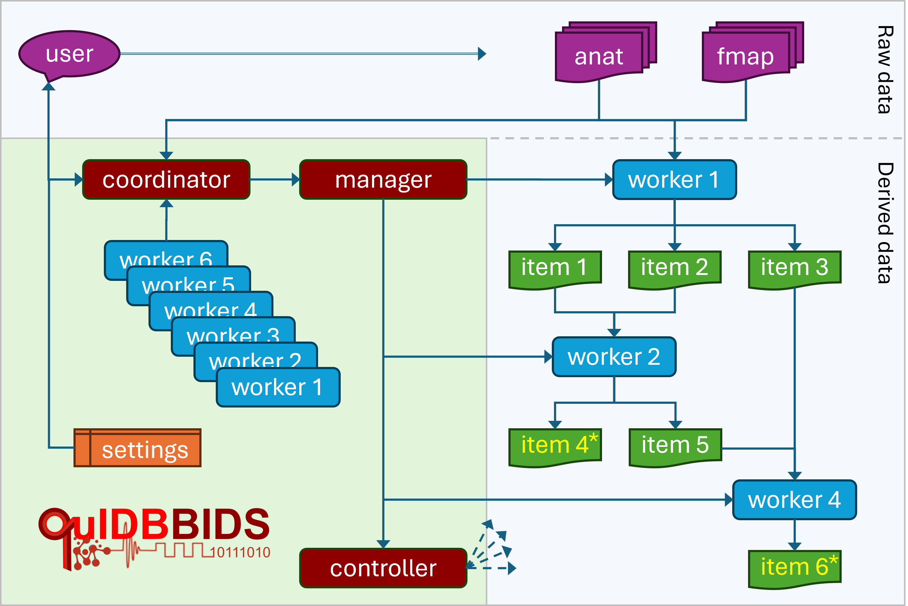
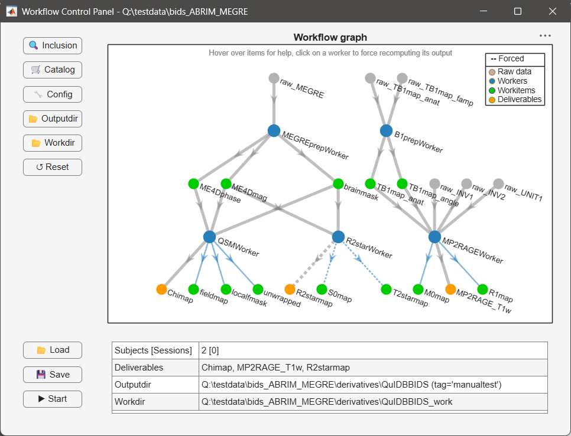
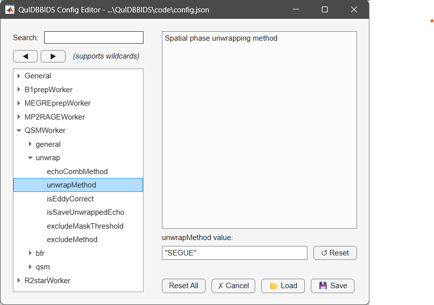
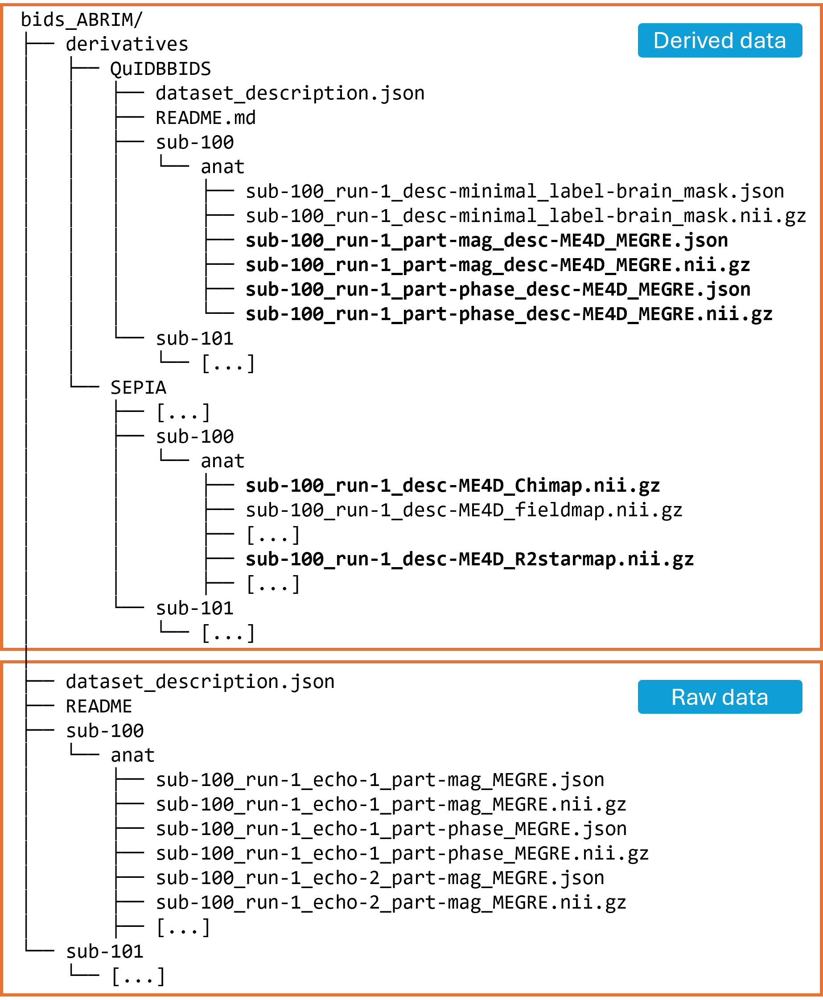
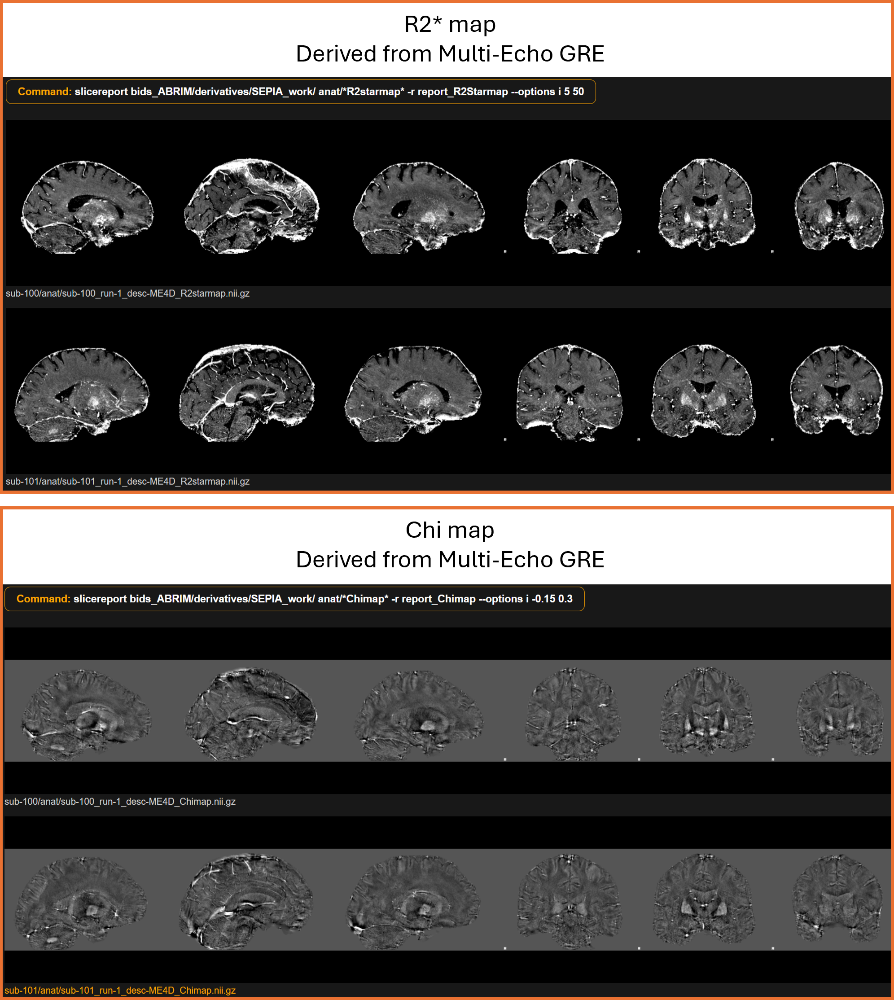

Screenshots
===========

QuIDBBIDS architecture
----------------------

   Overview of the QuIDBBIDS workflow. The user specifies the data and desired workitems (``4*`` and ``6*``)
   to the coordinator. The coordinator inspects the worker pool, interacts with the user to edit settings
   (algorithm parameters and additional metadata), and activates the manager. The manager puts workers ``1``,
   ``2``, and ``4`` into a team and directs them to process the input data (“anat” and “fmap”), collaboratively
   producing workitems ``1–6``. Finally, the manager initiates a controller to verify successful completion.

Workflow Control Panel
----------------------

   The main QuIDBBIDS GUI: setup buttons on the left, the workflow graph in the center (raw input data as grey
   nodes prefixed with ``raw*``, e.g. ``rawMEGRE``, at the top; the team of workers as blue nodes in the middle;
   the deliverables such as ``Chimap``, ``R2starmap`` and ``R1map`` as orange nodes at the bottom), workflow
   control buttons (Load/Save/Start) at the bottom left, and a summary table of the dataset and settings at the
   bottom right.

Configuration editor
--------------------

   Left panel: The General QuIDBBIDS settings as well as the settings for the individual workers. In this
   example the user navigated to a ``QSMWorker`` SEPIA menu item, whose value opens the native SEPIA GUI when
   edited. Right panel: the description of the selected parameter (top) with a box to edit its value (bottom).

QuIDBBIDS data
--------------

   Example of the raw input (bottom) and the corresponding QuIDBBIDS output data structure (top), showing
   how file and directory names, data formats, and metadata sidecar files are organized in accordance with the
   BIDS standard. Boldface filenames indicate work-items that are either needed or produced by the QSMWorker,
   i.e. input workitems from the “QuIDBBIDS” folder and output items in the “SEPIA” folder.

   R2*- and Chi-maps as computed by QuIDBBIDS from the input data (visualisation made with BIDScoin
   `slicereport <https://bidscoin.readthedocs.io/en/latest/bidsapps.html#quality-control>`__).
